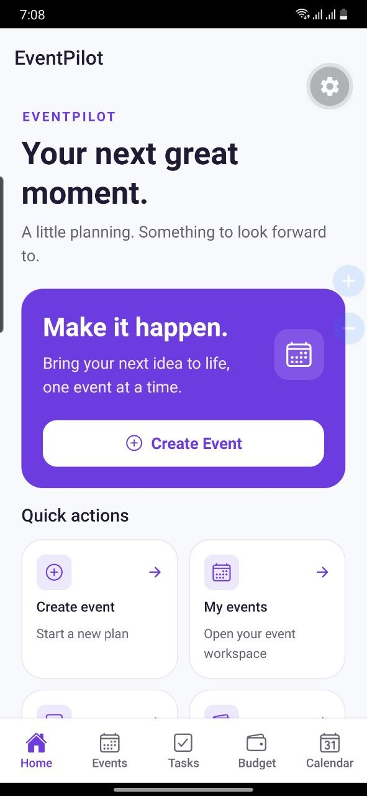
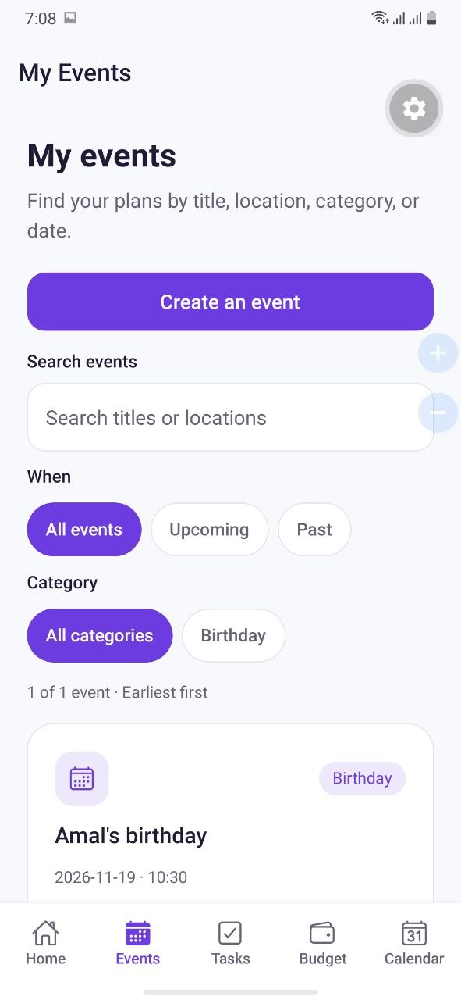
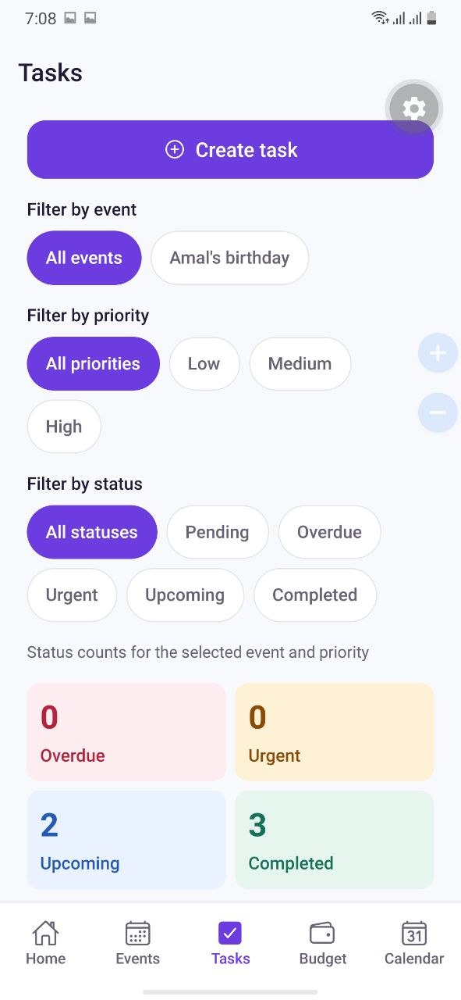
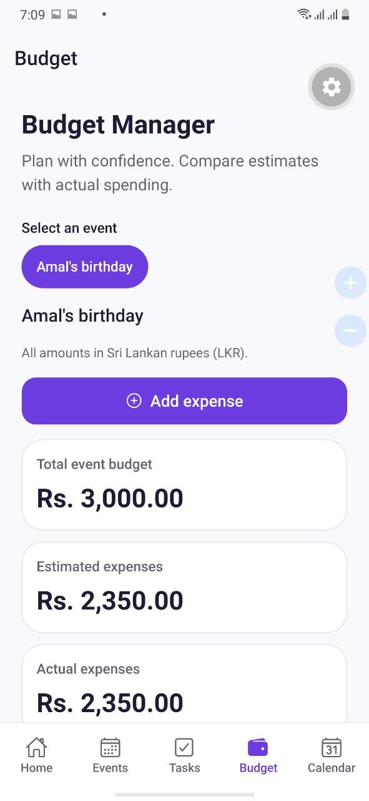
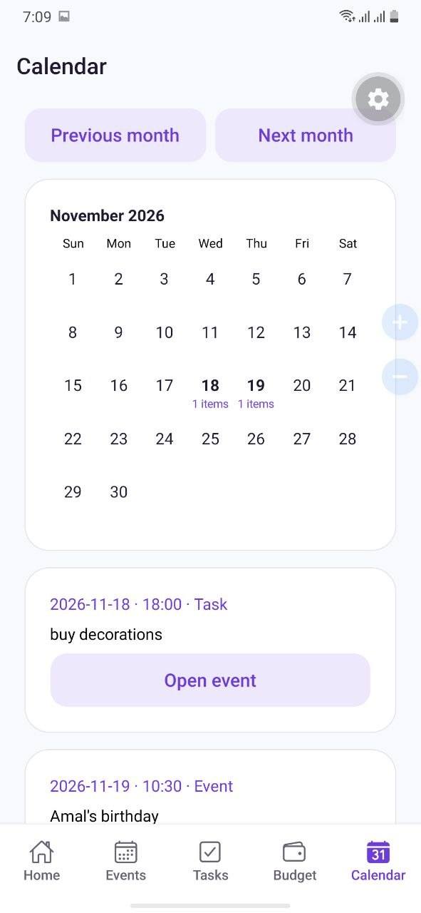

# EventPilot

**An offline event management app for planning events, organizing people, tracking tasks, and managing budgets in one place.**

Built with React Native, Expo, JavaScript, and SQLite, EventPilot provides a shared planning interface for web, Android, and iOS.

## Contents

- [Project overview](#project-overview)
- [Screenshots](#screenshots)
- [Problem statement](#problem-statement)
- [Objectives](#objectives)
- [Features](#features)
- [Technologies used](#technologies-used)
- [Installation and setup](#installation-and-setup)
- [Using EventPilot](#using-eventpilot)
- [Project structure](#project-structure)
- [Database and offline storage](#database-and-offline-storage)
- [Testing and verification](#testing-and-verification)
- [Current limitations](#current-limitations)
- [Future improvements](#future-improvements)
- [Troubleshooting](#troubleshooting)
- [Contributing](#contributing)
- [License](#license)

## Project overview

EventPilot helps organizers manage weddings, birthdays, conferences, and other events from initial planning through completion. Each event has its own tasks, expenses, activities, guest list, and vendor records.


## Screenshots

The five main tabs of EventPilot, captured on a mobile screen.

<table>
  <tr>
    <th>Home</th>
    <th>Events</th>
  </tr>
  <tr>
    <td></td>
    <td></td>
  </tr>
  <tr>
    <th>Tasks</th>
    <th>Budget</th>
  </tr>
  <tr>
    <td></td>
    <td></td>
  </tr>
  <tr>
    <th colspan="2">Calendar</th>
  </tr>
  <tr>
    <td colspan="2" align="center"></td>
  </tr>
</table>

## Problem statement

Event planning often spreads information across notebooks, spreadsheets, messaging apps, and separate calendars. This makes it easy to miss deadlines, schedule overlapping activities, lose guest responses, or overlook expenses.

Organizers also need access to their plans when internet connectivity is limited. EventPilot addresses these problems with a central offline workspace, deadline tracking, schedule conflict detection, and financial summaries based on saved records.

## Objectives

- Centralize event details, tasks, schedules, guests, vendors, and expenses.
- Support reliable local storage and offline planning.
- Make deadlines, incomplete work, and budget risks easy to identify.
- Reduce accidental schedule overlaps and invalid data entry.
- Measure preparation progress using actual task completion.
- Provide exports, backups, and recovery tools for event records.
- Offer a consistent interface across mobile and web.

## Features

### Dashboard and analytics

- Total, upcoming/ongoing, and completed/past event summaries.
- Next upcoming event cards with navigation to event details.
- Pending and urgent task counts, readiness progress, and budget warnings.
- Due reminders and shortcuts to planning tools.
- Refresh on returning to screens, with loading, error, and empty states.

### Event management

- Create, view, edit, and delete events with confirmation before deletion.
- Title, description, category, date, time, location, and total budget fields.
- Lifecycle statuses: draft, planning, ready, ongoing, completed, and cancelled.
- Optional end date/time, date/time inputs, and required-field validation.
- Search by title or location, category and upcoming/past filters, chronological sorting, clear filters, and no-results states.
- Wedding, birthday, and conference templates with starter tasks and unscheduled activities.
- Duplicate events as drafts, archive plans, and move events to Trash.

Duplication copies task, expense-estimate, and activity plans. It clears dates, task completion, and actual spending. Guests, vendors, payments, and receipts are not copied.

### Tasks and event readiness

- Create, edit, delete, complete, and reopen tasks belonging to an event.
- Task title, description, deadline, priority, and completion status.
- Filters by event, priority, and completion status.
- Calculated deadline indicators: **Completed**, **Overdue**, **Urgent** (within 48 hours), and **Upcoming**.
- Status counts and sorting that prioritizes overdue and urgent incomplete tasks.
- Readiness indicators in Event Details and Dashboard that refresh when tasks change.

```text
Readiness score = completed tasks / total tasks × 100
```

Events with no tasks display **Not Assessed** rather than 100%.

### Budget, expenses, and payments

- Select an event and create, edit, or delete its expenses.
- Expense category, description, estimated amount, and actual amount.
- Nonnegative amount validation and Sri Lankan rupee formatting (**LKR / Rs.**).
- Total budget, estimated expenses, actual expenses, remaining budget, and utilization percentage.
- Category totals/comparisons, progress indicators, and overspending warnings.
- Safe handling of zero budgets and events without expenses.
- Expense vendor links and payment deadlines.
- Payment history with amount, date, method, and notes; paid/outstanding balances, payment status, and overpayment indicators.
- Web receipt attachments for PNG, JPEG, and PDF files up to 2 MB.

Payments track settlement separately and do not count the same expense twice in financial totals.

### Timeline and calendar

- Add, edit, and delete activities with title, date, start/end time, and optional description.
- Chronological timelines and validation that end time follows start time.
- Same-event overlap detection that excludes the activity being edited.
- Warnings list conflicting activities; overlaps require explicit confirmation to override.
- Adjacent activities are allowed when one ends exactly as another begins.
- Calendar tab with a month grid, day selection, and agenda containing events, pending task deadlines, and activities.
- Calendar `.ics` export, including 24-hour alarms for event and activity starts.

### Guests and vendors

- Guest contact information, RSVP status, plus-ones, dietary requirements, and manual check-in.
- Guest filtering and confirmed attendee counts including plus-ones.
- Vendor service, contact details, quoted amount, booking status, and notes.
- Create, edit, and delete guests/vendors within their event workspace.

### Reminders, reports, and recovery

- Saved in-app reminders with event, title, date, and time; dismiss reminders when handled.
- Printable HTML event reports and guest/expense CSV exports.
- Versioned JSON backup and validated transactional restore.
- Restore archived events or events in Trash; permanently delete with confirmation.
- Local persistence across app restarts and browser reloads.

## Technologies used

| Technology | Purpose |
| --- | --- |
| React Native 0.88 | Mobile interface and shared components |
| Expo SDK 58 | Application development and platform tooling |
| JavaScript / React 19 | Application logic and JSX components |
| Expo Router | File-based routes, tabs, and navigation |
| SQLite / expo-sqlite | Local relational storage using the async API |
| React Native Web | Browser support |
| React Native Community DateTimePicker | Native date/time input |
| Expo vector icons | Interface icons |
| ESLint | Source linting |
| Playwright | Browser workflow testing |
| Node.js SQLite | Database and calculation test scripts |

Application source uses `.js`, including JSX components; platform-specific web variants use `.web.js`. TypeScript remains a development dependency for JavaScript project validation and the tests' ES-module loader, not as the application source language.

## Installation and setup

### Prerequisites

- Git and npm.
- **Node.js 24 or newer** for the documented setup and Node SQLite tests.
- A modern browser for web use.
- A compatible Expo Go installation or development build on a device/emulator for mobile development.
- Microsoft Edge for browser tests as currently configured.

### 1. Clone the repository

```sh
git clone https://github.com/sachimav/EventPilot.git
cd EventPilot/EventPilot
```

The app is in the repository's nested `EventPilot` directory. Run the remaining commands from the directory containing `package.json`.

### 2. Install dependencies

```sh
npm ci
```

### 3. Start development

```sh
npm start
```

Follow the Expo terminal instructions to open the app. Platform shortcuts are also available:

```sh
npm run web
npm run android
npm run ios
```

Android requires an available device/emulator. The iOS Simulator requires macOS and Xcode; a compatible physical-device setup can also be used.

### 4. Run the built web app

For a local web preview with SQLite's required cross-origin isolation headers:

```sh
npm run build:web
npm run preview
```

Open **http://127.0.0.1:4173**. The preview server supports direct links to event screens. Rebuild after source changes; the exported preview does not update automatically.

No backend credentials, API keys, or environment variables are required for current offline features. Database initialization and versioned migrations run automatically at startup.

## Using EventPilot

1. Open **Home** and select **Create Event**. Choose a blank plan or template.
2. Enter event details and save. No sample event is created automatically.
3. Open the event from **My Events** to access its guests, vendors, tasks, budget, timeline, and reports.
4. Use **Tasks** and **Budget** to work across events, or **Calendar** to review scheduled items.
5. Check Home for readiness, approaching deadlines, and budget warnings.
6. Open **Reminders** or **Data & recovery** through Home shortcuts. Export a backup before clearing browser data or moving devices.

Bottom navigation contains **Home, Events, Tasks, Budget, and Calendar**. The Events screen retains the heading **My Events**.

## Project structure

```text
EventPilot/                  # Application directory
├── src/
│   ├── app/                 # Expo Router screens and layouts
│   │   ├── (tabs)/          # Home, events, tasks, budget, calendar
│   │   └── events/          # Event creation and event workspaces
│   ├── components/          # Forms, cards, dashboards, managers
│   ├── constants/           # Theme and layout values
│   ├── database/            # Initialization, migrations, CRUD, backups
│   ├── hooks/               # Focus refresh and task clock hooks
│   └── utils/               # Validation, calculations, conflicts, exports
├── assets/                  # App icons and image assets
├── e2e/                     # Playwright browser workflows
├── scripts/                 # SQLite/logic tests and preview server
├── app.json                 # Expo configuration
├── jsconfig.json            # JavaScript project configuration
├── package.json             # Dependencies and commands
└── DATABASE.md              # Detailed database documentation
```

## Contributing

Open an issue describing the problem or proposed feature. Work on a separate branch, preserve offline data and migration compatibility, run relevant checks, and describe the behavior and validation in the pull request. Follow [AGENTS.md](AGENTS.md) for repository development guidance.
